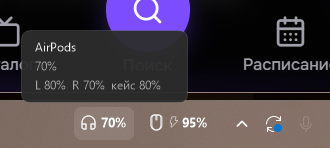

# BatteryTray

[Русская версия →](README.ru.md)

Battery level of your wireless headphones, mouse, keyboard and gamepad — **right on the Windows taskbar**.

No drivers, no admin rights, no network access. Single ~490 KB executable, ~30 MB RAM.



## Features

* **Taskbar chip** — device glyph + percentage, drawn with Segoe Fluent Icons so it blends into Windows 11
* **Hover highlight and tooltip** — the icon under the cursor gets a Windows-style highlight, the tooltip shows the device name and details
* **Several connection types at once** — 2.4 GHz dongles, Bluetooth LE, Apple Continuity (AirPods), USB HID, XInput
* **Per-device visibility** — hide any device you don't care about (right-click → *Отображаемые устройства*)
* **Only connected devices are shown** — everything is polled every 10 s, an icon disappears within ~25 s after you switch the device off
* **Charging indicator** — a lightning bolt before the percentage
* **Fullscreen-aware** — the chip hides while a game or app runs fullscreen
* Dark and light taskbar themes are respected
* Settings live in `%APPDATA%\BatteryTray\config.ini`

## Supported connections

| Provider | Typical devices | Status |
|---|---|---|
| Compx vendor HID (2.4 GHz dongle) | VGN, ATK, VXE, MAD mice and keyboards | ✅ tested on a VGN-class mouse |
| Apple Continuity BLE advertisement | AirPods 1–4 / Pro / Max, Beats | ✅ tested with AirPods Pro |
| Logitech HID++ 2.0 | Logitech mice/keyboards on Unifying / Bolt / Lightspeed receivers and Bluetooth | ⚠️ implemented, not tested on hardware |
| BLE GATT Battery Service (0x180F) | any BLE accessory with a standard battery service | ⚠️ implemented, not tested on hardware |
| Xbox XInput | Xbox One / Series controllers | ⚠️ implemented, not tested on hardware |
| HID Battery Strength (usage page 0x06 / 0x20) | accessories reporting battery over generic HID | ⚠️ implemented, not tested on hardware |

⚠️ means the code follows the published protocol, but the author could not verify it on real hardware.
Bug reports with the exact device model (and a HID report dump if possible) are welcome.

## Requirements

* Windows 10 / 11 (x64)
* Nothing else — the executable is statically linked

## Install

1. Download `BatteryTray.exe` from [Releases](../../releases).
2. Run it. The chip appears on the taskbar as soon as a supported device is connected.
3. Optional: right-click the chip → **Автозапуск с Windows**.

To close: right-click the chip → **Выход**, or run `BatteryTray.exe --exit`
(handy when no device is connected and the chip is hidden).

## Usage

| Action | Result |
|---|---|
| Hover an icon | Highlight + tooltip with device name and details |
| Left / right click | Menu: device list, *Отображаемые устройства*, *Обновить сейчас*, *Автозапуск*, *Выход* |
| `BatteryTray.exe --exit` | Closes the running instance |
| `BatteryTray.exe --dump-devices` | Writes detected devices to `%APPDATA%\BatteryTray\devices.txt` (debug) |

Settings file:

```ini
[general]
autostart=0
debug=0

[hidden]
; devices that are not displayed (id=1)
compx:13652:62726=1
```

## Build

Requirements: Visual Studio 2022 (Desktop C++) with the Windows 10/11 SDK.

```cmd
build.bat
```

Output: `BatteryTray.exe` (statically linked CRT, no runtime dependencies).

Source layout:

```
src/common.h            shared types (Device, IProvider), glyph table
src/config.*            settings in %APPDATA%\BatteryTray\config.ini
src/chip.*              taskbar chip + tooltip rendering (GDI+, Segoe Fluent Icons)
src/providers.h         provider factory
src/hid_providers.cpp   Compx (VGN/ATK/VXE), Logitech HID++, generic HID battery
src/ble_providers.cpp   Apple Continuity advertisement + BLE GATT battery service
src/xinput_provider.cpp Xbox controllers
src/main.cpp            window, polling, hover, menu, taskbar placement
```

## How it works

* Windows 11 does not allow third-party taskbar widgets, so the chip is a small layered window
  (per-pixel alpha, `WS_EX_NOACTIVATE`) placed inside the taskbar, left of the notification area.
* Transparent pixels are click-through (`WM_NCHITTEST` returns `HTTRANSPARENT`), so the taskbar keeps working normally.
* After a click on the taskbar, Explorer raises its window band; BatteryTray re-raises the chip on
  `EVENT_SYSTEM_FOREGROUND` and once per second.
* Apple battery data comes from the BLE proximity-pairing advertisement. Only devices **paired with this PC
  and currently connected** are accepted, and only known Apple models — a neighbour's AirPods are ignored.
* A device is treated as disconnected when its provider stops answering for ~25 s.

## Known limitations

* AirPods report battery in the advertisement in **10 % steps** (80 / 90 / 100), and only while they are
  advertising and connected to the PC.
* 2.4 GHz accessories answer only while they are awake; while a mouse sleeps its icon may disappear.
* Windows does not expose a battery level for every peripheral. Some 2.4 GHz dongles use an undocumented
  protocol variant (for example `3554:FA09`) that is not supported yet.

## License

MIT — see [LICENSE](LICENSE).
