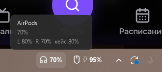

# BatteryTray

[English version →](README.md)

Заряд беспроводных наушников, мыши, клавиатуры и геймпада — **прямо на панели задач Windows**.

Без драйверов, без прав администратора, без обращения к сети. Один exe ~490 КБ, ~30 МБ ОЗУ.



## Возможности

* **Плашка в панели задач** — значок устройства + процент, нарисовано шрифтом Segoe Fluent Icons, поэтому выглядит как часть Windows 11
* **Подсветка и подсказка при наведении** — значок под курсором подсвечивается, всплывающая подсказка показывает название устройства и детали
* **Несколько типов подключения одновременно** — донглы 2.4 ГГц, Bluetooth LE, Apple Continuity (AirPods), USB HID, XInput
* **Скрытие отдельных устройств** — правый клик → *Отображаемые устройства*
* **Показываются только подключённые устройства** — опрос каждые 10 с, иконка исчезает через ~25 с после отключения
* **Индикатор зарядки** — молния перед процентом
* **Не мешает в играх** — плашка прячется, когда на весь экран работает приложение или игра
* Поддерживаются тёмная и светлая темы панели задач
* Настройки хранятся в `%APPDATA%\BatteryTray\config.ini`

## Поддерживаемые подключения

| Источник данных | Типичные устройства | Статус |
|---|---|---|
| Вендорский HID Compx (донгл 2.4 ГГц) | мыши и клавиатуры VGN, ATK, VXE, MAD | ✅ проверено на мыши класса VGN |
| Реклама Apple Continuity (BLE) | AirPods 1–4 / Pro / Max, Beats | ✅ проверено на AirPods Pro |
| Logitech HID++ 2.0 | мыши/клавиатуры Logitech на приёмниках Unifying / Bolt / Lightspeed и по Bluetooth | ⚠️ реализовано, на железе не проверялось |
| BLE GATT Battery Service (0x180F) | любые BLE-устройства со стандартным сервисом батареи | ⚠️ реализовано, на железе не проверялось |
| Xbox XInput | геймпады Xbox One / Series | ⚠️ реализовано, на железе не проверялось |
| HID Battery Strength (usage page 0x06 / 0x20) | устройства, отдающие заряд через стандартный HID | ⚠️ реализовано, на железе не проверялось |

⚠️ — код написан по опубликованному протоколу, но автор не смог проверить его на реальном устройстве.
Сообщения об ошибках приветствуются: укажите точную модель устройства (и, если можно, дамп HID-отчётов).

## Требования

* Windows 10 / 11 (x64)
* Больше ничего — исполняемый файл статически слинкован

## Установка

1. Скачайте `BatteryTray.exe` из раздела [Releases](../../releases).
2. Запустите. Плашка появится на панели задач, как только подключится поддерживаемое устройство.
3. По желанию: правый клик по плашке → **Автозапуск с Windows**.

Закрыть: правый клик по плашке → **Выход** либо команда `BatteryTray.exe --exit`
(удобно, когда ни одно устройство не подключено и плашка скрыта).

## Использование

| Действие | Результат |
|---|---|
| Навести на значок | Подсветка + подсказка с названием устройства и деталями |
| Левый / правый клик | Меню: список устройств, *Отображаемые устройства*, *Обновить сейчас*, *Автозапуск*, *Выход* |
| `BatteryTray.exe --exit` | Закрывает запущенный экземпляр |
| `BatteryTray.exe --dump-devices` | Пишет найденные устройства в `%APPDATA%\BatteryTray\devices.txt` (отладка) |

Файл настроек:

```ini
[general]
autostart=0
debug=0

[hidden]
; устройства, которые не отображаются (id=1)
compx:13652:62726=1
```

## Сборка

Нужно: Visual Studio 2022 (Desktop C++) с Windows SDK 10/11.

```cmd
build.bat
```

Результат: `BatteryTray.exe` (статический CRT, без зависимостей).

Структура исходников:

```
src/common.h            общие типы (Device, IProvider), таблица глифов
src/config.*            настройки в %APPDATA%\BatteryTray\config.ini
src/chip.*              отрисовка плашки и подсказки (GDI+, Segoe Fluent Icons)
src/providers.h         фабрика провайдеров
src/hid_providers.cpp   Compx (VGN/ATK/VXE), Logitech HID++, стандартный HID-заряд
src/ble_providers.cpp   Apple Continuity и BLE GATT Battery Service
src/xinput_provider.cpp геймпады Xbox
src/main.cpp            окно, опрос, наведение, меню, позиционирование в панели задач
```

## Как это работает

* Windows 11 не позволяет сторонние виджеты панели задач, поэтому плашка — это маленькое слоистое окно
  (попиксельная прозрачность, `WS_EX_NOACTIVATE`), размещённое внутри панели задач слева от области уведомлений.
* Прозрачные пиксели «сквозные» для мыши (`WM_NCHITTEST` возвращает `HTTRANSPARENT`), панель задач работает как обычно.
* После клика по панели задач Explorer поднимает своё окно выше; BatteryTray возвращает плашку наверх
  по событию `EVENT_SYSTEM_FOREGROUND` и раз в секунду.
* Данные AirPods берутся из рекламы BLE proximity pairing. Принимаются только устройства,
  **сопряжённые с этим ПК и подключённые сейчас**, и только известные модели Apple — чужие AirPods рядом игнорируются.
* Устройство считается отключённым, если его источник данных не отвечает ~25 с.

## Известные ограничения

* AirPods передают заряд в рекламе **шагом 10 %** (80 / 90 / 100) и только пока рекламируются и подключены к ПК.
* Устройства на 2.4 ГГц отвечают только когда не спят; пока мышь спит, её иконка может пропадать.
* Windows отдаёт заряд не для всех периферийных устройств. Некоторые донглы 2.4 ГГц используют
  недокументированный вариант протокола (например, `3554:FA09`) — он пока не поддерживается.

## Лицензия

MIT — см. [LICENSE](LICENSE).
